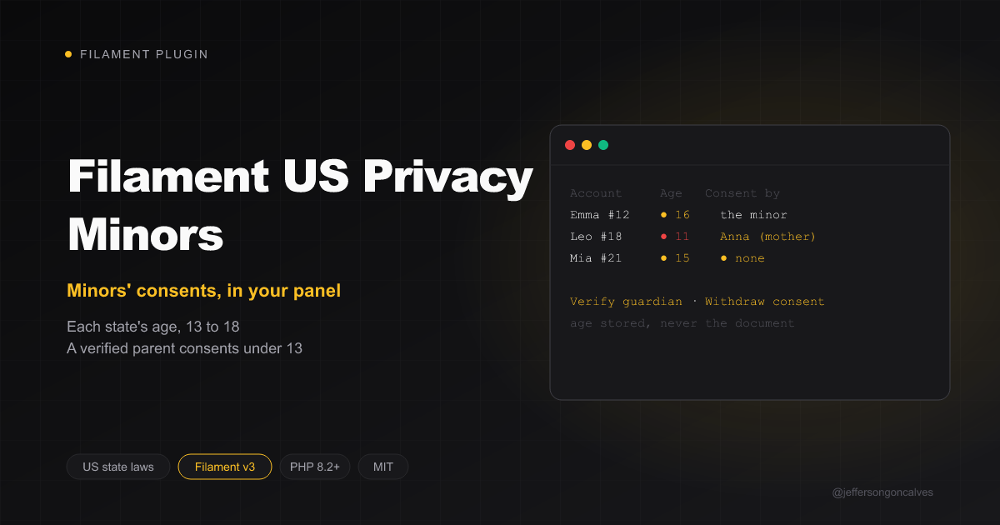

<div class="filament-hidden">



</div>

# Filament US Privacy Minors

[](https://packagist.org/packages/jeffersongoncalves/filament-us-privacy-minors)
[](https://github.com/jeffersongoncalves/filament-us-privacy-minors/actions?query=workflow%3Atests+branch%3A1.x)
[](https://github.com/jeffersongoncalves/filament-us-privacy-minors/actions?query=workflow%3A"Fix+PHP+code+styling"+branch%3A1.x)
[](https://packagist.org/packages/jeffersongoncalves/filament-us-privacy-minors)
[](LICENSE.md)

Minors under the US state privacy laws in your Filament panel, built on [laravel-us-privacy-minors](https://github.com/jeffersongoncalves/laravel-us-privacy-minors): age check results, parent or guardian links with verification, and minors' consents for targeted advertising and sale, with withdrawal.

> This plugin gives you tooling. It does not make you compliant on its own.

## Features

- Age checks with the age, the method and whether it is reliable, filtered by validity and under 18.
- Guardian links: create, verify (a parent consents under 13, COPPA) and revoke.
- Minors' consents: who gave each one (the minor or a parent) and withdrawal.
- 19 languages.

## Compatibility

| Plugin Version | Filament |
|---|---|
| [1.x](https://github.com/jeffersongoncalves/filament-us-privacy-minors/tree/1.x) | 3.x |
| [2.x](https://github.com/jeffersongoncalves/filament-us-privacy-minors/tree/2.x) | 4.x |
| [3.x](https://github.com/jeffersongoncalves/filament-us-privacy-minors/tree/3.x) | 5.x |

## Installation

```bash
composer require jeffersongoncalves/filament-us-privacy-minors:"^1.0"
```

Install and configure [laravel-us-privacy-minors](https://github.com/jeffersongoncalves/laravel-us-privacy-minors) first.

## Usage

```php
use JeffersonGoncalves\Filament\UsPrivacyMinors\UsPrivacyMinorsPlugin;

public function panel(Panel $panel): Panel
{
    return $panel
        ->plugins([
            UsPrivacyMinorsPlugin::make()
                ->subjectTitleAttribute('email')
                ->navigationGroup('Privacy')   // default: no group
                ->navigationSort(2),
        ]);
}
```

All fluent methods are optional.

> The pages have no authorization of their own: register the plugin only on panels whose users may see them, or override `canAccess()` in a subclass.

## Related plugins

- [filament-us-privacy](https://github.com/jeffersongoncalves/filament-us-privacy): personal data inventory and the state law rules.
- [filament-us-privacy-opt-out](https://github.com/jeffersongoncalves/filament-us-privacy-opt-out): opt-outs, sensitive data consent and Global Privacy Control.
- [filament-us-privacy-requests](https://github.com/jeffersongoncalves/filament-us-privacy-requests): consumer requests and appeals.
- [filament-us-privacy-notices](https://github.com/jeffersongoncalves/filament-us-privacy-notices): processing activities behind the privacy notice.
- [filament-us-privacy-assessments](https://github.com/jeffersongoncalves/filament-us-privacy-assessments): data protection assessments.
- [filament-us-privacy-vendors](https://github.com/jeffersongoncalves/filament-us-privacy-vendors): processors and third parties.

## Testing

```bash
composer test
```

## Changelog

Please see [CHANGELOG](CHANGELOG.md) for more information on what has changed recently.

## Contributing

Please see [CONTRIBUTING](.github/CONTRIBUTING.md) for details.

## Security Vulnerabilities

Please review [our security policy](../../security/policy) on how to report security vulnerabilities.

## Credits

- [Jefferson Gonçalves](https://github.com/jeffersongoncalves)
- [All Contributors](../../contributors)

## License

The MIT License (MIT). Please see [License File](LICENSE.md) for more information.
